<p align="center">
  
</p>

<h1 align="center">splitMe</h1>

<p align="center">
  Split bills with friends, see who owes whom, and settle up in a tap.<br/>
  Android · Kotlin · Jetpack Compose · Firebase
</p>

---

## How the app works

The screenshots below follow a new user from first launch to settling up. They're from a Samsung Galaxy in dark mode; the app also has a light theme that follows the phone's setting.

### 1. Onboarding

On first launch, two slides explain what the app does. They're shown only once: after **Get Started** (or **Skip**) the app goes straight to sign-in next time.

<p align="center">
  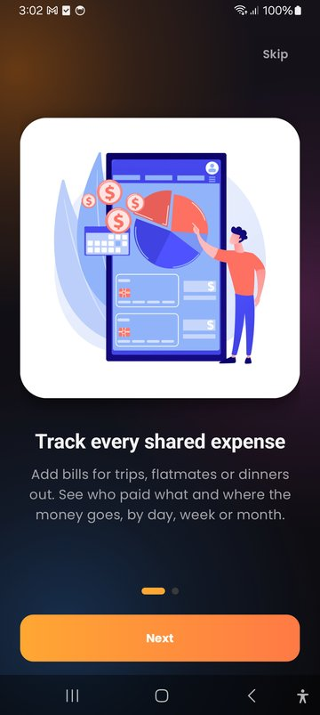
  &nbsp;&nbsp;
  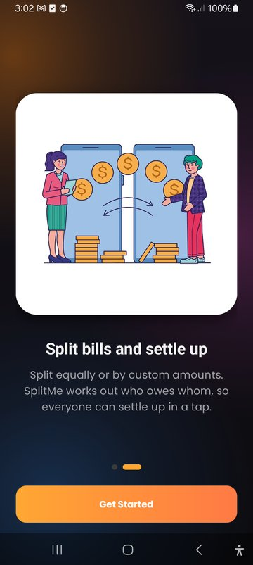
</p>

### 2. Sign in with your mobile number

There are no passwords. You enter your mobile number, and the country is picked automatically from your SIM. Tap the flag to choose another country; the list can be searched by name or dialling code. The number is checked for that country before a code is sent.

<p align="center">
  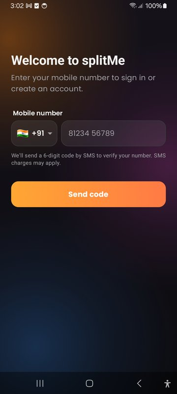
  &nbsp;&nbsp;
  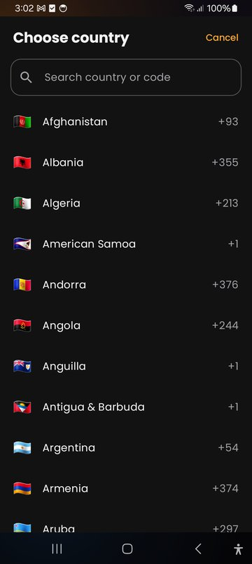
</p>

### 3. Verify the code

Firebase sends a 6-digit code by SMS. The code is checked as soon as the sixth digit is entered. **Resend code** unlocks after 30 seconds, and **Change number** goes back a step.

A new user then enters their name once. If friends had already added this number from their contacts, the new account joins those groups automatically and takes over its bills.

<p align="center">
  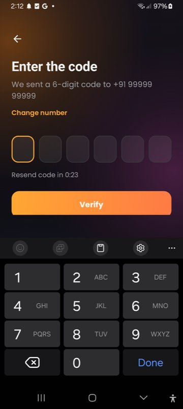
</p>

### 4. Dashboard

The home screen shows your overall balance across all your groups: how much you're owed and how much you owe. Below that are a spending chart (by day, week, month or year), spending by category, and a summary of balances with each person.

<p align="center">
  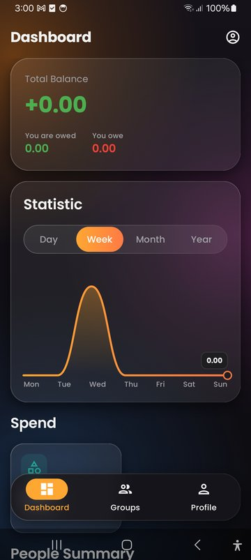
  &nbsp;&nbsp;
  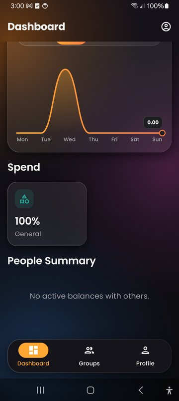
</p>

### 5. Groups

Each group shows its total spending, member count and your balance in it. Only groups you belong to or created are listed. Tap **+** to create a group, or use the **⋮** menu to add people from your contacts or delete the group.

<p align="center">
  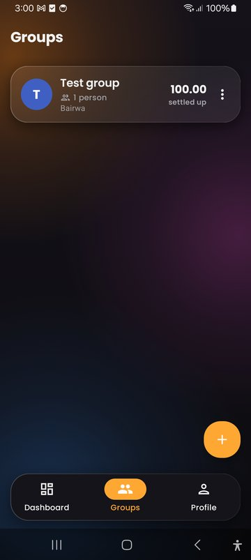
  &nbsp;&nbsp;
  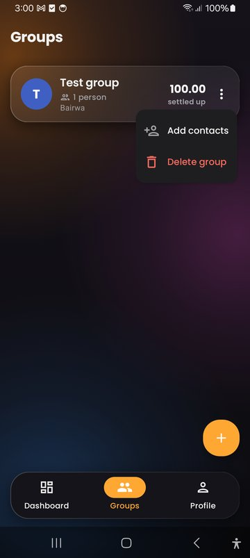
</p>

### 6. Inside a group

A group shows its total spending, each member's balance and the most recent bills. The icon at the top right adds people, either from your phone contacts or by typing a name and number.

<p align="center">
  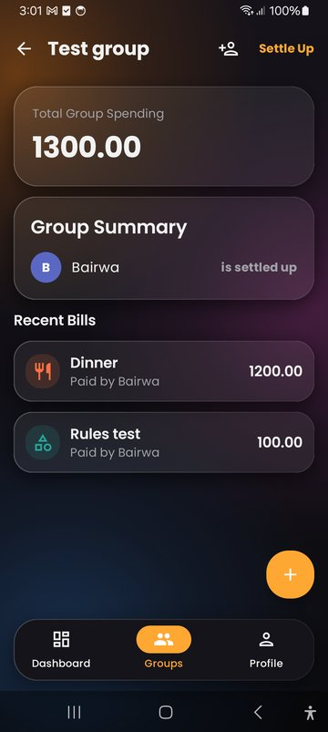
</p>

### 7. Add a bill

Enter a title and amount, pick a category and who paid, then split it **equally** or **manually** with exact amounts per person. The app checks that the shares add up to the total.

<p align="center">
  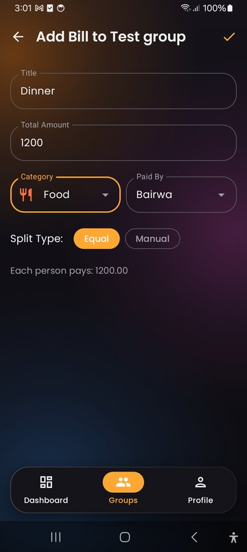
  &nbsp;&nbsp;
  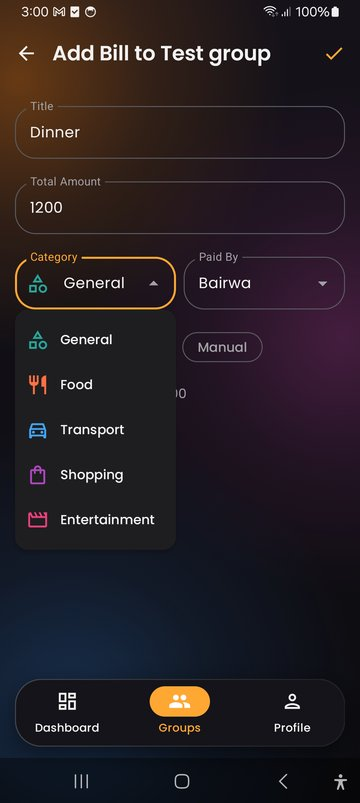
</p>

### 8. Settle up

**Settle Up** shows each member's net balance and suggests who should pay whom to clear everyone's debts. Recording a payment updates the balances straight away.

<p align="center">
  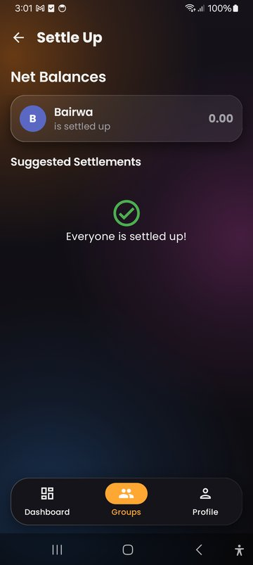
</p>

### 9. Profile

You can edit your name, date of birth, location and app language, and add a profile photo. Your mobile number is shown as verified and can't be edited, since it's what you sign in with. The photo shows next to your name everywhere in the app. The log-out button is at the top right.

<p align="center">
  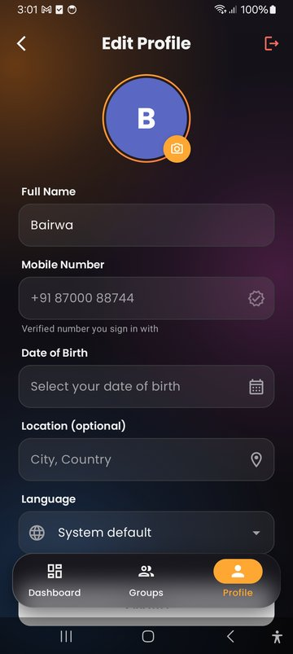
</p>

---

## Features

- **Phone number sign-in:** Firebase phone authentication, with a searchable country code picker and per-country number checks.
- **Groups and bills:** equal or manual splits, categories, and per-group and overall balances.
- **Settle up:** suggested payments that clear everyone's debts.
- **Contacts:** add people from your phone book. When they sign up, they automatically join the groups they were added to.
- **Profile:** name, date of birth, location, language and photo, all with validation.
- **Three languages:** English (default), Hindi and Spanish, switchable in the app.
- **Light and dark themes** with a glass-style design, plus a side rail on tablets.
- **Private data:** Firestore security rules let people see only the groups and bills they belong to.

## Tech stack

| | |
|---|---|
| Language | Kotlin |
| UI | Jetpack Compose, Material 3, [Haze](https://github.com/chrisbanes/haze) (blurred glass bottom bar) |
| Architecture | MVVM with repositories, Kotlin Coroutines and Flow |
| Backend | Firebase Authentication (phone), Cloud Firestore |
| Libraries | libphonenumber (phone formatting and validation), Coil (images), DataStore (onboarding flag), AppCompat (per-app language) |
| Android | minSdk 24, targetSdk 35 |

## Project structure

```
app/src/main/java/com/shubh/splitme/
├── data/            Firebase repositories, phone number helpers, contacts, preferences
├── domain/          Models (Member, Group, Bill) and repository interfaces
└── ui/
    ├── auth/        Phone sign-in, code and name steps
    ├── onboarding/  First-launch slides
    ├── dashboard/   Home screen and charts
    ├── group/       Groups list, group details, settle up
    ├── bill/        Add bill
    ├── member/      Contacts and adding people
    ├── profile/     Edit profile, photo, validation
    ├── components/  Shared widgets (avatars, phone input, cards)
    └── theme/       Colors, light/dark themes, glass styles
firestore.rules      Firestore security rules
```

## Running it

1. Open the project in Android Studio and run the `app` configuration, or build from the command line:

   ```bash
   ./gradlew :app:assembleDebug
   ```

2. The app uses the Firebase project in `app/google-services.json`. To use your own project, replace that file and in the Firebase console:
   - Under **Authentication → Sign-in method**, enable **Phone**. For testing, add numbers under *Phone numbers for testing*; those never send a real SMS.
   - Under **Authentication → Settings → SMS region policy**, allow the countries you want to send codes to.
   - Add your app's SHA-1 and SHA-256 fingerprints under **Project settings → Your apps**.
   - Publish [`firestore.rules`](firestore.rules) under **Firestore Database → Rules**.

   Real SMS codes need the Blaze (pay-as-you-go) plan; test numbers work on the free Spark plan.

3. Run the unit tests:

   ```bash
   ./gradlew :app:testDebugUnitTest
   ```
